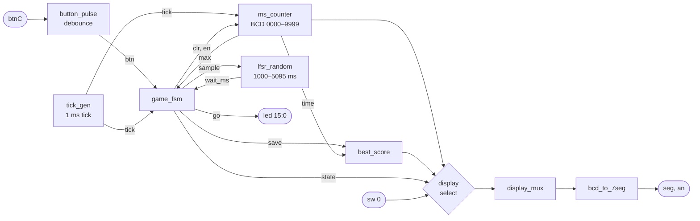
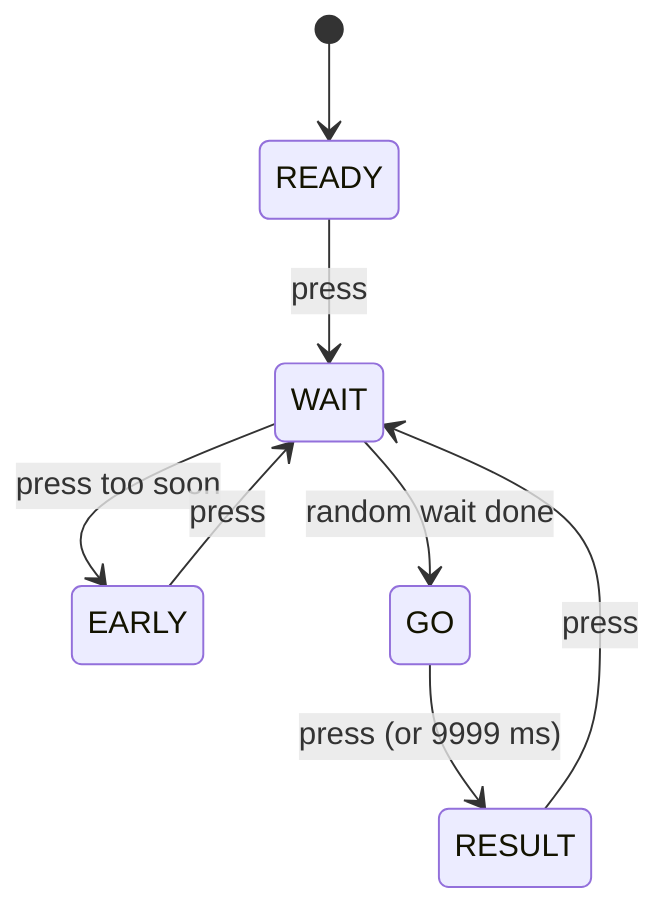
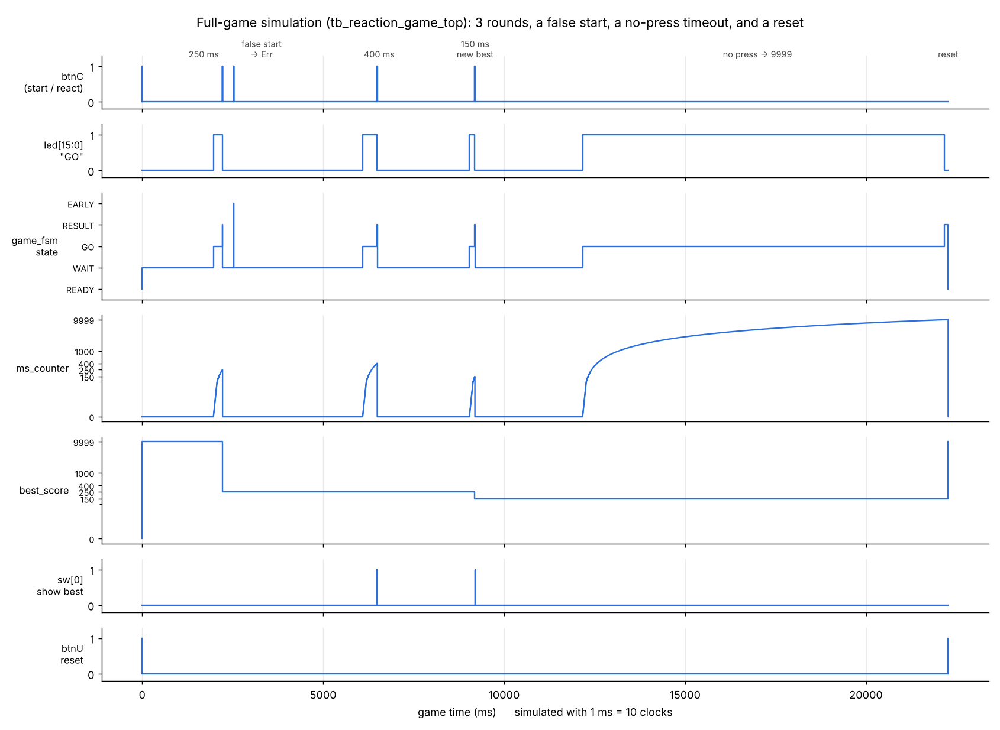

# Reaction-Time Game (Basys 3, Verilog)


**COMPE 470L – Digital Logic Laboratory · SDSU · Fall 2026 · Final Project**

A reaction-time game on the Digilent Basys 3 FPGA board.
Press the button to start. After a random wait of 1–5 seconds, the LEDs light up.
Press again as fast as you can. Your time in milliseconds shows on the seven-segment display.
Press too early and you get `Err`. The board keeps your best time.

## Controls

| Input / Output | Use |
|---|---|
| `btnC` | Start a round / react |
| `btnU` | Reset (also clears the best time) |
| `sw[0]` | On the result screen: 0 = last time, 1 = best time |
| `led[15:0]` | All 16 on = "GO" |
| 7-segment | `----` ready / waiting · live ms during GO · your time after · `Err` on a false start |

## How it works

### Block diagram



### Game state machine



| State | LEDs | Display |
|---|---|---|
| READY | off | `----` |
| WAIT | off | `----` |
| GO | **on** | ms counting up |
| RESULT | off | last time (sw[0]=0) or best time (sw[0]=1) |
| EARLY | off | `Err` |

### Design notes

- **Random wait:** a 16-bit LFSR runs on every clock. When you press start, it grabs the value. The exact clock you press on is random, so the wait is random too.
- **Counting in BCD:** `ms_counter` counts as 4 BCD digits, so the display needs no binary-to-BCD converter. Packed BCD can be compared like a normal number, so `best_score` needs no converter either.
- **Debounce:** `button_pulse` (from Lab 6) waits for the button to be stable for 10 ms and gives one pulse per press.

## Modules

| Module | What it does | Status |
|---|---|---|
| `tick_gen` | 1 ms tick from the 100 MHz clock | ✅ tested |
| `ms_counter` | Counts 0000–9999 ms in BCD, stops at 9999 | ✅ tested |
| `lfsr_random` | 16-bit LFSR, random wait of 1000–5095 ms | ✅ tested |
| `button_pulse` | Debounce + one-clock pulse (from Lab 6) | ✅ tested |
| `display_mux` | Shows 4 digits, one at a time (from Lab 6) | ✅ tested |
| `bcd_to_7seg` | Digit to segments, plus `-`, `E`, `r` (from Lab 6) | ✅ |
| `game_fsm` | READY → WAIT → GO → RESULT / EARLY | ✅ tested |
| `best_score` | Saves the fastest time | ✅ tested |
| `reaction_game_top` | Top module | ✅ full-game test passes |
| Board test | Basys 3 | ⏳ Nov 23 |

## Simulation

The full-game testbench plays the game like a person: a normal round, a false start, a slower round, a new best, a no-press timeout, and a reset.



```
Round 1: random wait 1965 ms, reaction 250 ms
Round 2: false start -> display shows Err
Round 3: random wait 3565 ms, reaction 400 ms
         sw[0]=1 shows best = 250 ms
Round 4: random wait 2544 ms, reaction 150 ms
         sw[0]=1 shows new best = 150 ms
Round 5: no press -> stops at 9999
Reset:   back to READY, best = 9999
PASS: tb_reaction_game_top
```

### Run the tests

With [Icarus Verilog](https://steveicarus.github.io/iverilog/):

```bash
./sim/run_all.sh
```

Every testbench prints `PASS` or `FAIL`. GitHub runs all of them on every push (see the badge at the top). They also run in the Vivado simulator.

## Build the bitstream

```bash
vivado -mode batch -source scripts/build.tcl
```

This makes `build/reaction_game.bit`. Or use the Vivado GUI: see [docs/lab_day_checklist.md](docs/lab_day_checklist.md). Part: `xc7a35tcpg236-1`.

## Folders

```
src/          Verilog source
sim/          Self-checking testbenches + run_all.sh
constraints/  Basys 3 XDC file
scripts/      Vivado build script, waveform plot script
docs/         Simulation plot, lab-day checklist
```

## Progress

- **Nov 16, 2026** – Proposal approved. Added `tick_gen`, `ms_counter`, `lfsr_random` with testbenches.
- **Nov 16, 2026** – Added `button_pulse`, `bcd_to_7seg` (from Lab 6), `display_mux` (taken out of the Lab 6 clock), testbenches, and the Basys 3 XDC.
- **Nov 16, 2026** – Added `game_fsm`, `best_score`, `reaction_game_top`, `Err` and `-` on the display, a full-game testbench, and a Vivado build script.
- **Nov 19, 2026** – Added block and state diagrams, simulation plot, `run_all.sh`, GitHub Actions tests, and a lab-day checklist.

## Reference

Idea based on [Reaction timer / reflex tester in Verilog](https://simplefpga.blogspot.com/2013/03/reaction-timer-reflex-tester-in-verilog.html) (simplefpga.blogspot.com).
